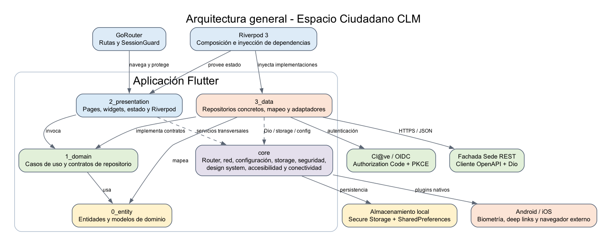

# Control del documento

| Campo | Valor |
|---|---|
| Proyecto | Espacio Ciudadano CLM |
| Tipo de documento | Arquitectura técnica e informe de funcionalidades |
| Fecha de revisión | 12 de junio de 2026 |
| Rama revisada | `feature/cicd` |
| Revisión de código | `9ba3de2` |
| Versión de aplicación | `0.1.0` |
| Fuente de verificación | Código fuente, configuración, dependencias, rutas y pipeline del repositorio |

# Resumen ejecutivo

Espacio Ciudadano CLM es una aplicación móvil multiplataforma desarrollada con Flutter para facilitar el acceso de la ciudadanía a servicios digitales de la Junta de Comunidades de Castilla-La Mancha. La solución adopta una arquitectura modular **Feature First** combinada con principios de **Clean Architecture**, de forma que cada capacidad funcional se organiza como un módulo independiente y separa modelo de dominio, reglas de negocio, presentación e infraestructura.

La base técnica actualmente disponible cubre el acceso público, la autenticación federada con Cl@ve mediante OIDC, la gestión del ciclo de vida de sesión, el consentimiento inicial, la selección de hechos vitales, las páginas legales, la biometría para recuperar una sesión y varios servicios transversales. La pantalla principal autenticada y la mayor parte de los dominios de negocio previstos todavía no están operativos en esta revisión.

El repositorio incluye un cliente generado desde la especificación OpenAPI de Fachada Sede. Este cliente contiene contratos para numerosos servicios futuros, pero su existencia no implica que todos ellos estén integrados en la aplicación. En la revisión analizada, la integración funcional de negocio con Fachada Sede se concentra en **Hechos Vitales**.

# Alcance y criterio de evaluación

Este documento describe el estado real de la rama y revisión indicadas. La clasificación funcional se ha realizado atendiendo a cuatro niveles:

| Estado | Criterio |
|---|---|
| Disponible | Existe interfaz utilizable, flujo conectado y comportamiento implementado. |
| Parcial | Existe una parte del flujo o una superficie visual, pero faltan navegación, datos reales, persistencia remota o comportamiento final. |
| Soporte técnico | Componente transversal disponible para ser consumido por funcionalidades, sin constituir por sí mismo una capacidad de usuario final. |
| No disponible | Capacidad prevista, documentada o presente en OpenAPI, pero no integrada en la aplicación actual. |

No se consideran funcionalidades disponibles las cadenas de traducción, endpoints generados, documentos de discovery ni componentes visuales que no tengan una ruta y un flujo operativo en el código actual.

# Visión general de la solución

{ width=90% }

La aplicación se divide en dos grandes áreas:

- `lib/features/`: módulos funcionales independientes.
- `lib/core/`: capacidades compartidas de aplicación, configuración, navegación, red, almacenamiento, seguridad, accesibilidad y sistema de diseño.

Las funcionalidades activas en la revisión analizada son `landing`, `auth`, `consent`, `personalization`, `legal` y `external_links`. El módulo `design_system` ofrece un catálogo interno de componentes y no se considera una funcionalidad de negocio.

# Stack tecnológico

## Plataforma y lenguaje

| Área | Tecnología | Uso en el proyecto |
|---|---|---|
| Framework móvil | Flutter, fijado por FVM en `3.41.7` | Base común para Android e iOS. |
| Lenguaje | Dart, restricción `^3.10.1` | Lógica, interfaz, integraciones y modelos. |
| UI | Material, componentes propios y fuente Roboto | Construcción de pantallas y sistema visual corporativo. |
| Android | Kotlin/Gradle, Java 17 para compilación | Integración nativa, biometría y deep links. |
| iOS | Xcode/CocoaPods, iOS 13 o superior | Integración nativa, Face ID y esquema URL de callback. |

## Librerías principales

| Responsabilidad | Tecnología/versión bloqueada | Función |
|---|---|---|
| Estado e inyección | `flutter_riverpod 3.0.3` | Estado reactivo, composición e inyección de dependencias. |
| Navegación | `go_router 17.2.2` | Rutas declarativas, deep links y guardas de sesión. |
| HTTP | `dio 5.9.2` | Acceso REST, interceptores, reintentos y tratamiento de errores. |
| Cliente API | OpenAPI Generator `7.21.0`, API `1.41.0` | Cliente Dart tipado para Fachada Sede. |
| Autenticación | `flutter_appauth 12.0.0` | Flujo OIDC Authorization Code con PKCE contra Cl@ve. |
| Almacenamiento seguro | `flutter_secure_storage 10.0.0` | Tokens de acceso, refresco y caducidad de sesión. |
| Preferencias | `shared_preferences 2.5.5` | Consentimiento, onboarding y opciones no secretas. |
| Biometría | `local_auth 3.0.1` | Huella, Face ID u otro mecanismo biométrico soportado. |
| Conectividad | `connectivity_plus 6.1.5` | Detección de estado online/offline. |
| Enlaces externos | `url_launcher 6.3.2` | Apertura controlada de destinos HTTPS. |
| Internacionalización | `flutter_localizations` + `intl 0.20.2` | Recursos en español e inglés. |
| Recursos gráficos | `flutter_svg 2.3.0` | Logotipos e iconografía vectorial. |

## Configuración y entornos

La configuración se inyecta en compilación mediante `--dart-define-from-file`. Existen ficheros diferenciados para desarrollo, preproducción y producción con los siguientes parámetros:

- Nombre y flavor de aplicación.
- URL base de Fachada Sede.
- Timeout de red.
- Activación de modo debug.
- URL, realm, client ID y redirect URI de SSO.

`AppConfig` transforma estas variables en una configuración tipada y Riverpod la distribuye desde el `ProviderScope` creado durante el arranque.

# Arquitectura Feature First CLEAN

## Principio Feature First

En una organización por capas globales, todos los modelos, repositorios y pantallas del producto se agrupan por tipo técnico. Este proyecto utiliza el enfoque contrario: cada funcionalidad mantiene juntas todas sus piezas. El objetivo es reducir acoplamiento, facilitar la localización del código y permitir que los equipos trabajen sobre módulos con límites claros.

Estructura de referencia:

```text
lib/features/<feature>/
  0_entity/          Entidades y objetos de valor
  1_domain/          Casos de uso y contratos de repositorio
  2_presentation/    Pantallas, widgets, estado y providers
  3_data/            Repositorios concretos, API, DTO y mapeo
```

La numeración hace explicito el orden conceptual de las capas y mantiene una estructura predecible en todos los módulos.

## Responsabilidad de las capas

| Capa | Responsabilidad | Dependencias permitidas |
|---|---|---|
| `0_entity` | Representar conceptos del negocio con tipos inmutables y sin dependencias de UI o infraestructura. | Dart y utilidades puras. |
| `1_domain` | Definir acciones del sistema mediante casos de uso y contratos abstractos de repositorio. | Entidades de la propia funcionalidad. |
| `2_presentation` | Renderizar la interfaz, mantener estado de pantalla y orquestar casos de uso. | Dominio, entidades, Riverpod, Flutter y servicios de `core`. |
| `3_data` | Acceder a API, almacenamiento o plugins y convertir datos externos a entidades de dominio. | Contratos de dominio, Dio, cliente generado y servicios de `core`. |

La regla principal es que el dominio no debe conocer la implementación técnica. La presentación solicita una operación a un caso de uso, el caso de uso depende de un contrato y Riverpod conecta dicho contrato con la implementación concreta de `3_data`.

## Composición e inyección de dependencias

Riverpod actúa como raíz de composición:

1. `bootstrap` crea el almacenamiento local y monta el `ProviderScope`.
2. Los providers transversales exponen configuración, Dio, almacenamiento y sesión.
3. Cada feature define providers para sus repositorios y casos de uso.
4. Los notifiers consumen casos de uso y publican un estado inmutable a la UI.
5. Las pantallas reaccionan a cambios de estado y ejecutan navegación o feedback visual.

Este patrón permite sustituir repositorios o plugins mediante overrides, aunque la rama actual todavía no incluye una batería de tests que aproveche esa capacidad.

## Ejemplo real: Hechos Vitales

La funcionalidad `personalization` ilustra el flujo completo:

```text
LifeEventsPage
  -> LifeEventsNotifier
    -> Load/SaveLifeEventsUsecase
      -> LifeEventsRepository (contrato)
        -> LifeEventsRepositoryImpl
          -> Dio / HechosVitalesApi
            -> Fachada Sede REST
```

Los modelos generados por OpenAPI se mantienen en la capa de datos. Antes de regresar al dominio se transforman en entidades `LifeEvent`, evitando que la interfaz dependa del formato de transporte.

Existe una adaptación puntual: la respuesta real del endpoint de consulta llega envuelta en un objeto distinto al descrito por OpenAPI. Por ello, la lectura utiliza Dio directamente para extraer `body.listaHechos`, mientras que el guardado utiliza el cliente generado. Esta excepción está encapsulada dentro de `3_data`.

## Nivel de adopción y excepciones actuales

La arquitectura descrita representa el patrón objetivo y se aplica de forma clara en Consentimiento y Hechos Vitales. La implementación actual presenta algunas excepciones que conviene registrar como deuda técnica controlada:

| Excepción | Situación actual | Evolución recomendada |
|---|---|---|
| Tipos de AppAuth en dominio | El contrato `AuthRepository` y los casos de uso exponen `TokenResponse` de `flutter_appauth`. | Definir una entidad de sesión propia y realizar el mapeo en `3_data`. |
| Rutas centralizadas | `app_router.dart` registra directamente las pantallas de todas las features. | Permitir que cada feature publique sus rutas y agregarlas desde el router principal. |
| Módulos informativos sin cuatro capas | `legal` solo necesita presentación porque sirve contenido estático. | Mantenerlo documentado como excepción o crear capas vacías si se exige uniformidad estricta. |
| Landing sin fuente de datos | Su repositorio es un punto de extensión sin comportamiento; el contenido se resuelve localmente. | Conservarlo mientras no exista CMS y eliminar abstracciones si no aportan valor futuro. |


## Servicios transversales de core

`core` contiene capacidades compartidas que no pertenecen a un único dominio:

- Arranque de aplicación y configuración por entorno.
- Cliente Dio e interceptores de autenticación, refresco y errores.
- GoRouter, registro central de rutas y `SessionGuard`.
- Secure Storage y SharedPreferences mediante abstracciones propias.
- Autenticación biométrica.
- Detección de conectividad y banner offline reutilizable.
- Sistema de diseño, temas, tipografía, componentes y estados de UI.
- Helpers de accesibilidad y recursos de internacionalización.
- Logging y limpieza de ficheros temporales.

# Flujos técnicos principales

## Arranque

```text
main
  -> AppConfig.fromEnvironment
  -> bootstrap
     -> SharedPreferences
     -> limpieza de sesión segura si es una instalación nueva
     -> ProviderScope con overrides
  -> MaterialApp.router
     -> tema, localización y GoRouter
```

La limpieza de primera instalación evita recuperar tokens que el sistema operativo pudiera haber restaurado desde una copia de seguridad sin que existan preferencias locales coherentes.

## Autenticación y onboarding

```text
Landing pública
  -> Acceder
  -> Cl@ve OIDC + PKCE
  -> Callback por deep link
  -> UserInfo y claims JWT
  -> Sesión temporal en memoria
  -> Validación de consentimiento
     -> Información legal con lectura hasta el final
     -> Selección de autorizaciones opcionales
     -> Persistencia del consentimiento y de la sesión
  -> Onboarding de hechos vitales
     -> Consulta y selección
     -> Guardado en backend
  -> Home autenticada
```

Las rutas autenticadas pasan por `SessionGuard`. La guarda hidrata la sesión almacenada, refresca el token si ha caducado, fuerza el consentimiento y controla que el onboarding de hechos vitales se haya completado.

## Red y sesión

El cliente Dio común configura URL base, timeouts, cabeceras JSON y los siguientes interceptores:

- `AuthInterceptor`: incorpora el Bearer token vigente.
- `AuthRefreshInterceptor`: ante un `401`, intenta refrescar la sesión y repite la petición una sola vez.
- `ErrorInterceptor`: convierte errores de transporte en errores tipados de aplicación.
- Interceptores de logging para diagnóstico técnico.

Los tokens se almacenan en Secure Storage. El consentimiento y los indicadores de onboarding se guardan por `idAgente` en SharedPreferences. Los datos funcionales de Hechos Vitales se consultan y actualizan en backend.

# Seguridad, accesibilidad y calidad transversal

## Seguridad

- OIDC Authorization Code con PKCE mediante librería nativa especializada.
- Tokens fuera de SharedPreferences y almacenados en Secure Storage.
- Renovación silenciosa y limpieza de sesión ante fallos de refresco.
- Cierre de sesión local y, cuando existe `idToken`, cierre federado en Cl@ve.
- Acceso biométrico opcional para recuperar una sesión persistida.
- Catálogo cerrado de enlaces externos, validando esquema HTTPS y host.
- `android:allowBackup="false"` para evitar copias de seguridad de datos Android.

Como medida pendiente de endurecimiento, el logging HTTP debe condicionarse estrictamente a entornos no productivos y redactar cabeceras o cuerpos sensibles. En la implementación actual los interceptores de diagnóstico se incorporan al cliente común sin una condición visible por flavor.

## Accesibilidad e internacionalización

El sistema de diseño incorpora semántica, tamanos tactiles, etiquetas, estados de carga/error/vacío y componentes reutilizables. Las pantallas principales utilizan `Semantics` y textos accesibles. La aplicación registra recursos para español e inglés.

La internacionalización es parcial: existen recursos bilingües, pero permanecen textos de interfaz y documentos legales codificados directamente en español. Antes de declarar soporte completo en inglés debe realizarse una auditoría de cadenas y contenidos.

## Integración continua

El repositorio incluye:

- Imagen Docker reproducible para Flutter Android, Android SDK, Jenkins y Fastlane.
- Flutter `3.41.7` fijado en FVM y en la imagen CI.
- Pipeline Jenkins parametrizable para APK o App Bundle.
- Selección de fichero de entorno mediante `--dart-define-from-file`.
- Ejecución opcional de `flutter test` y archivado de artefactos.

La automatización actual está centrada en Android. La firma release usa todavía la configuración debug y los identificadores Android/iOS conservan valores `com.example`, por lo que la configuración de publicación no debe considerarse cerrada.

# Informe de funcionalidades disponibles

## Funcionalidades disponibles

| Funcionalidad | Estado | Descripción y alcance real |
|---|---|---|
| Landing pública | Disponible | Pantalla institucional con acceso, ayuda y descripción de Espacio Ciudadano. |
| Ayuda de acceso | Disponible | Explicación de métodos de identificación y acción para iniciar el login. |
| Información sobre el servicio | Disponible | Pagina informativa previa a la autenticación. |
| Login con Cl@ve | Disponible | OIDC con PKCE, navegador seguro, callback por deep link y consulta de UserInfo. |
| Claims de identidad | Disponible | Lectura de JWT y extracción de datos como `sub`, nombre, NIF/id e `idAgente`. |
| Gestion de sesión | Disponible | Sesión en memoria, persistencia segura, hidratación, refresco y limpieza. |
| Cierre de sesión | Disponible | Limpieza local y cierre federado best effort cuando existe `idToken`. |
| Acceso biométrico | Disponible | Activación opcional y recuperación de sesión mediante biometría del dispositivo. |
| Consentimiento inicial | Disponible | Lectura obligatoria del texto legal, autorizaciones opcionales y persistencia por ciudadano. |
| Rechazo del consentimiento | Disponible | Cierre de sesión y retorno a la landing. |
| Hechos Vitales | Disponible | Consulta real, selección, guardado y limpieza de selecciones contra Fachada Sede. |
| Onboarding de Hechos Vitales | Disponible | Ejecución obligatoria en el primer acceso y registro local por ciudadano. |
| Protección de datos | Disponible | Documento legal navegable, con búsqueda interna en el acceso desde home. |
| Aviso legal | Disponible | Pagina estática integrada en la navegación autenticada. |
| Declaración de accesibilidad | Disponible | Pagina estática integrada en la navegación autenticada. |
| Ayuda y contacto | Disponible | Pantalla informativa accesible desde el menú autenticado. |
| Enlace a sede externa | Disponible | Apertura controlada de Sede Electrónica DGT desde el menú. |
| Recuperación ante `401` | Disponible | Refresco de token y repetición única de la solicitud original. |

## Funcionalidades parciales o de soporte

| Funcionalidad | Estado | Limitación actual |
|---|---|---|
| Home autenticada | Parcial | Existen cabecera, menú, navegación inferior y FAB, pero el contenido central contiene textos de maqueta. |
| Navegación inferior | Parcial | Se puede cambiar la selección visual entre cinco pestanas, pero no cambia el contenido ni navega a módulos funcionales. |
| Menu de usuario | Parcial | Logout y enlaces legales funcionan; `Mi perfil` y `Carnets digitales` no tienen acción conectada. |
| Identificación digital/FAB | Parcial | Control visual presente con un `TODO`, sin destino funcional. |
| Consentimiento | Parcial | Se guarda localmente y el catálogo de cláusulas es estático; no existe versionado que fuerce una nueva aceptación. |
| Internacionalización ES/EN | Parcial | Infraestructura y catálogos presentes, con cadenas y textos legales aún codificados en español. |
| Estado offline | Soporte técnico | Provider y banner disponibles, pero la home actual no los integra. |
| Catálogo de enlaces externos | Soporte técnico | Inventario seguro de varios portales; solo una parte está conectada a superficies activas. |
| Sistema de diseño | Soporte técnico | Amplio conjunto de componentes y catálogo interno para desarrollo y validación visual. |
| Cliente OpenAPI | Soporte técnico | Contratos tipados de numerosos servicios, aunque solo Hechos Vitales está integrado como feature de negocio actual. |

## Funcionalidades no disponibles en la aplicación actual

Las siguientes capacidades aparecen en textos, documentación inicial, discovery o contratos OpenAPI, pero no tienen módulos funcionales activos en `lib/features` ni rutas operativas en la revisión analizada:

| Área | Estado |
|---|---|
| Dashboard funcional por dominios | No disponible |
| Gestion y consulta de expedientes | No disponible |
| Aportación documental y firma | No disponible |
| Notificaciones y detalle de notificaciones | No disponible |
| Agenda y citas sanitarias | No disponible |
| Recomendaciones personalizadas | No disponible |
| Carnets digitales, PDF, QR y Wallet | No disponible |
| Datos de educación | No disponible |
| Datos de empleo | No disponible |
| Datos sanitarios | No disponible |
| Bienestar social y familia numerosa | No disponible |
| Catastro, residencia y vehiculos | No disponible |
| Perfil de usuario editable | No disponible |

El cliente generado contiene endpoints relacionados con varias de estas áreas. Para convertirlos en funcionalidades es necesario implementar entidades, casos de uso, repositorios, estados de UI, pantallas, navegación, tratamiento de errores y pruebas.

# Estado técnico y riesgos identificados

| Observación | Impacto | Recomendación |
|---|---|---|
| Home autenticada sin contenido funcional | El usuario completa el onboarding pero llega a una superficie de maqueta. | Priorizar la home y su navegación real antes de una entrega funcional. |
| Sin tests versionados | No existe red automatizada de regresión para dominio, repositorios, guardas o UI. | Crear tests unitarios, de widgets e integración para los flujos críticos. |
| Consentimiento sin versionado | Un cambio legal no fuerza una nueva aceptación. | Persistir versión aceptada y compararla con la versión vigente. |
| Cláusulas almacenadas localmente | La aceptación no queda registrada en backend en esta implementación. | Alinear persistencia con requisitos legales y endpoint oficial. |
| Logging HTTP no condicionado por flavor | Riesgo de exponer tokens o datos personales en logs. | Deshabilitar en producción y aplicar redacción de PII y secretos. |
| Contrato OpenAPI no coincide con una respuesta real | La carga de Hechos Vitales necesita parseo manual. | Corregir la especificación o mantener un adaptador cubierto por tests. |
| Firma e identificadores de app provisionales | Los artefactos no están configurados para publicación oficial. | Definir application ID, bundle ID, certificados y gestión segura de claves. |
| Documentación histórica desalineada | Algunos informes mencionan módulos no presentes en esta rama. | Regenerar inventarios desde código y versionarlos por release. |

# Validación realizada

La validación estática ejecutada el 12 de junio de 2026 sobre la revisión indicada obtuvo:

- `flutter analyze --no-fatal-infos`: sin errores y sin warnings.
- 24 observaciones de nivel informativo, principalmente estilo, referencias de comentarios y APIs deprecadas en componentes del sistema de diseño.
- 133 ficheros Dart versionados bajo `lib`.
- 0 tests versionados bajo `test` o `integration_test`.

No se ha realizado en este documento una prueba end-to-end contra entornos reales de Cl@ve o Fachada Sede. La disponibilidad funcional descrita se basa en trazabilidad de código, rutas, providers, repositorios e integraciones.

# Conclusiones

La solución dispone de una base arquitectónica coherente para crecer por funcionalidades, con separación de responsabilidades, inyección de dependencias, cliente API tipado, seguridad de sesión y un sistema de diseño reutilizable. El flujo de entrada, consentimiento y Hechos Vitales constituye el primer recorrido completo de usuario.

El estado actual debe considerarse una **base funcional en evolución**, no una versión completa de Espacio Ciudadano. Para avanzar hacia una entrega productiva se recomienda priorizar:

1. Home autenticada y navegación funcional.
2. Registro remoto y versionado de consentimientos.
3. Pruebas automatizadas de autenticación, guardas, consentimiento y Hechos Vitales.
4. Hardening de logs, identificadores y firma de release.
5. Integración incremental del resto de dominios siguiendo el patrón Feature First CLEAN ya establecido.

# Anexo: principales evidencias de código

| Área | Ubicación principal |
|---|---|
| Arranque | `lib/main.dart`, `lib/core/app/bootstrap.dart` |
| Configuración | `lib/core/config/app_config.dart` |
| Router y guardas | `lib/core/routing/app_router.dart`, `session_guard.dart` |
| Cliente HTTP | `lib/core/network/api_client.dart`, `network_interceptors.dart` |
| Autenticación | `lib/features/auth/` |
| Landing y home | `lib/features/landing/` |
| Consentimiento | `lib/features/consent/` |
| Hechos Vitales | `lib/features/personalization/` |
| Paginas legales | `lib/features/legal/` |
| Cliente OpenAPI | `generated/dart_dio_client/` |
| Pipeline Android | `Jenkinsfile`, `gitlab-ci/docker/flutter-android/Dockerfile` |
